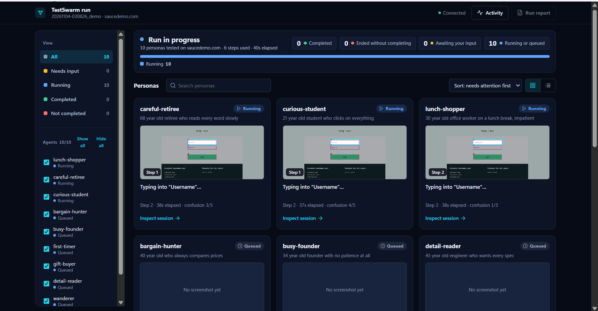
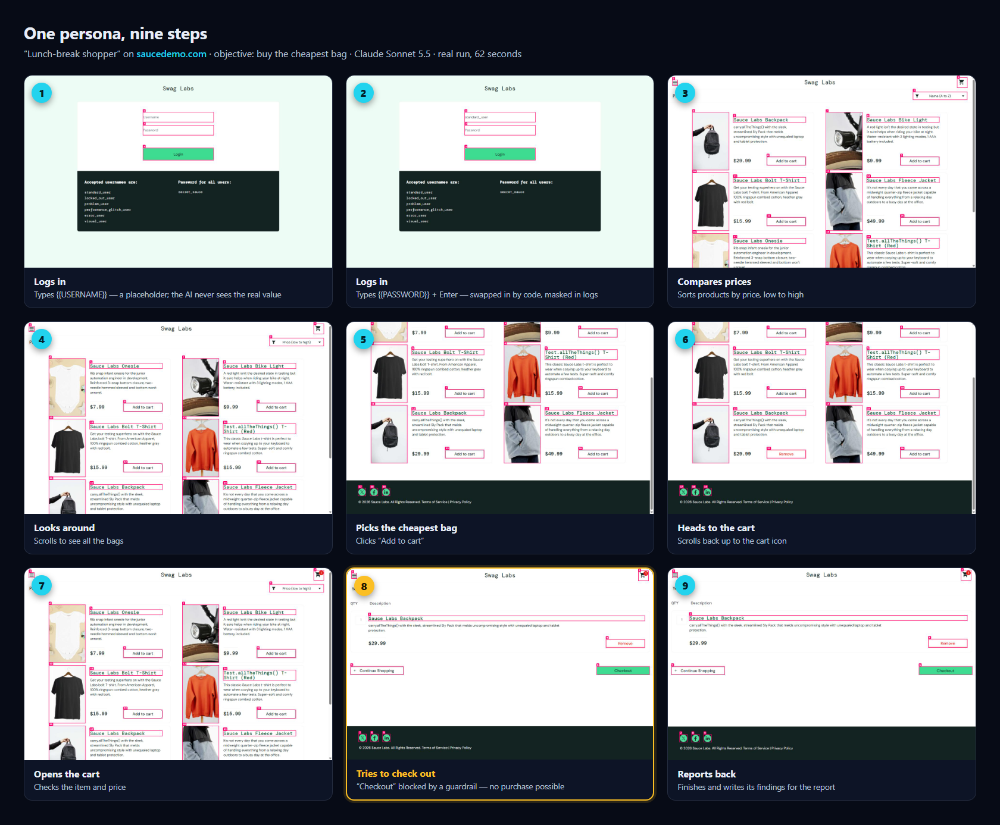
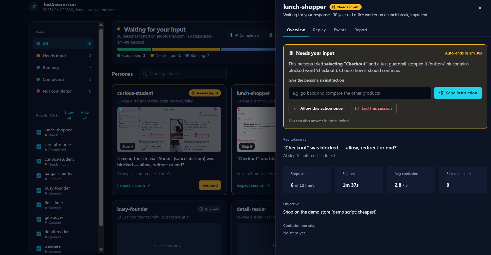

<p align="center">
  
</p>

<p align="center">
  <b>Send a swarm of AI "users" through your website before real people do.</b><br>
  Each agent is a persona with its own goal, patience and tech skills. It opens a real browser,
  clicks, types, gets confused, gives up — and tells you why.
</p>

<p align="center">
  <a href="#quick-start">Quick start</a> ·
  <a href="#try-it-free-demo-mode">Free demo</a> ·
  <a href="#the-live-dashboard">Dashboard</a> ·
  <a href="#safety-guardrails">Guardrails</a> ·
  <a href="#configuration">Configuration</a>
</p>



---

## What it does

You describe a few personas in plain English — *"65 year old retired teacher, not comfortable with
technology, gives up when confused"* — and give each one an objective — *"find out what this costs
and decide whether you'd sign up"*. TestSwarm then:

- 🧑‍💻 **Runs each persona in its own real Chromium browser** (via Playwright). Real clicks, real typing, real page loads.
- 👀 **Lets Claude see the page** as a screenshot with numbered labels on every clickable element, plus the text of the page.
- 🎭 **Keeps the agent in character** — an impatient persona skims and quits; a careful one reads everything.
- 🛡️ **Enforces safety rules in code**, not by trusting the AI: no payments, no card details, no leaving your site.
- ✋ **Pauses and asks you** when something is blocked, a CAPTCHA appears, or your API credits run out.
- 📺 **Shows everything live** on a local dashboard, with step-by-step replay.
- 📝 **Writes a report per persona** — where they struggled, bugs, what worked, and recommendations — plus a summary across all personas.

### One persona, nine steps

A real run: an impatient "lunch-break shopper" trying to buy the cheapest bag on a demo store.
The guardrail stops it at checkout, exactly as configured.



> **Honest note:** AI personas simulate *plausible* behaviour, not real human behaviour.
> Use TestSwarm to find problems early and cheaply, then validate what matters with real users.

---

## How it works

```
personas.yaml ──► persona + objective ──► Claude decides ONE action per step
                                              │
                    screenshot + element list │  click / type / scroll / navigate / note / give up / finish
                                              ▼
                     real browser  ◄── guardrails check every action and every network request
                                              │
                         step log, screenshots, live dashboard ──► report.md per persona + summary.md
```

Every step: the agent **looks** (screenshot + page text), **thinks** in character, picks **one action**,
the **guardrails** approve or block it, the browser **acts**, and everything is **logged**.

---

## Quick start

### 1. What you need

| | |
|---|---|
| **Python 3.11+** | Check with `python --version` (tested on 3.12). Get it from [python.org](https://www.python.org/downloads/). |
| **Git** | To download the project. |
| **An Anthropic API key** | Only for real runs (the demo is free). Create one at [console.anthropic.com](https://console.anthropic.com). |
| **~1 GB free RAM per 2–3 browsers** | Each persona's browser uses roughly 300–500 MB. |

### 2. Download and install

```bash
git clone https://github.com/M-Kushaal/TestSwarm.git
cd TestSwarm

# create an isolated Python environment
python -m venv .venv
# activate it — Windows:
.venv\Scripts\activate
# activate it — macOS / Linux:
source .venv/bin/activate

# install the libraries and the browser
pip install -r requirements.txt
playwright install chromium
```

### 3. Try it free: demo mode

No API key, no cost. Ten scripted personas shop on [saucedemo.com](https://www.saucedemo.com)
(a public practice store) so you can see the browsers, the dashboard, the pauses and the reports:

```bash
python -m testswarm demo
```

Your browser opens the dashboard at **http://127.0.0.1:8765**. Some demo personas deliberately hit
guardrails, so you can try answering them. Demo reports say "DEMO MODE" — the analysis is fake;
everything else is real.

### 4. Add your API key

Copy the example settings file and put your key in it:

```bash
# Windows
copy .env.example .env
# macOS / Linux
cp .env.example .env
```

Open `.env` and replace `sk-ant-your-key-here` with your real key. `.env` is git-ignored — never share it.

### 5. Run a real persona

The project ships with an example persona that shops on the practice store:

```bash
python -m testswarm check                  # checks your settings, files and API key
python -m testswarm run --agent shopper    # runs one persona
```

Watch the browser and the dashboard, then open the report in `runs/<date-time>_shopper/report.md`.

### 6. Point it at your own app

Edit **`personas.yaml`**: set `url:` to your site and describe your personas (see below). Then:

```bash
python -m testswarm run --all
```

---

## Define your personas

Everything lives in **`personas.yaml`**. One entry = one agent.

```yaml
url: https://your-app.example.com        # where every persona starts

agents:
  - name: retired-teacher                # short id: lowercase, no spaces
    persona: >
      65 year old retired school teacher. Not comfortable with technology,
      reads everything slowly, anxious about entering personal information,
      gives up if something is confusing for too long.
    objective: >
      Find out what this website offers and how much it costs.
      Decide whether you would sign up, and explain why or why not.

  - name: busy-founder
    persona: >
      34 year old startup founder, very impatient, skims pages, expects to
      understand the value in under 10 seconds.
    objective: >
      Figure out in as few clicks as possible whether this product solves
      your problem, then try to start a free trial.
    url: https://your-app.example.com/pricing   # optional: a different start page
```

**To add an agent, add another entry.** Tips:

- **Persona:** age or role, tech comfort, patience, mood and worries. TestSwarm expands your short
  description into a full profile and saves it with the run (`persona.yaml`).
- **Objective:** a concrete goal plus what to report — *"…and explain why or why not."*
- **Logins:** write `{{USERNAME}}` / `{{PASSWORD}}` in the objective and define them in `.env` (see [Logins](#logins-and-secrets)).

---

## Running

| Command | What it does |
|---|---|
| `python -m testswarm check` | Validates `config.yaml`, `personas.yaml` and `.env` without running anything |
| `python -m testswarm list` | Lists your personas |
| `python -m testswarm run --agent shopper` | Runs one persona |
| `python -m testswarm run -a shopper -a retired-teacher` | Runs several, in parallel |
| `python -m testswarm run --all` | Runs every persona in `personas.yaml` |
| `python -m testswarm run --all --url https://staging.example.com` | Same personas, different site |
| `python -m testswarm run --all --no-dashboard` | Without the web dashboard |
| `python -m testswarm demo [-n 5] [--parallel 2] [--headless]` | Free simulation, no API calls |

While a run is going, the terminal prints every step (tagged with the persona's name), each persona
gets its own browser window, and **Ctrl+C** stops everything cleanly.

---

## The live dashboard

Opens automatically at **http://127.0.0.1:8765** (only reachable from your own computer).



- **Run summary strip** — run state (*Run in progress · Waiting for your input · Run complete*), how many
  personas completed, ended without completing, need you, or are still running, and an outcome bar
  (click a segment to filter).
- **Sidebar** — filter by outcome, and tick/untick agents to show or hide them.
- **Compact persona cards** — outcome badge, a screenshot preview with the relevant element highlighted,
  and one key takeaway, e.g. *"“Checkout” was prevented by a test guardrail"* — clearly marked as a
  test restriction, not a site problem.
- **Inspector** (click a card) — *Overview* (takeaway, stats, confusion chart), *Replay* (step-by-step
  screenshots with the clicked element highlighted, action, result, persona reaction), *Events*, *Report*.
- **Activity** — important events across all personas; click one to jump to that step.
- **Grid / list view, search and sort** (needs attention first, most confused, …).

Confusion (1 = clear, 5 = lost) and mood are **self-reported by the persona simulation** at each step.

---

## Human in the loop

When a persona needs a person, **only that persona pauses** — the others keep going. Answer in the
dashboard or in the terminal:

| Situation | Your options |
|---|---|
| **An action was blocked by a guardrail** | **End** the session (default) · **Allow once** (only for blocked *words*, e.g. "checkout" on a test shop) · **type an instruction**, e.g. *"go back and compare the other products"* — the persona continues from the same page with the same memory |
| **A CAPTCHA appeared** | Solve it yourself in that persona's browser window, then **continue** — TestSwarm never bypasses CAPTCHAs |
| **API credits ran out / rate limit / no internet** | Top up or wait, then **retry** — nothing is lost — or end the session |

No answer within 5 minutes (configurable) ends that persona's session; its report is still written.

---

## Safety guardrails

The AI is told the rules, but **code enforces them** — every click, keystroke and network request is checked.

| Guardrail | What it does |
|---|---|
| **Clean, isolated browser** | Each persona gets a brand-new browser profile: no saved cards, passwords, cookies or autofill. Your own browser is never touched. |
| **Domain lock** | Personas can only navigate to the site you're testing (plus domains you explicitly allow). |
| **Payment blocklist** | All requests to payment providers (Stripe, PayPal, Razorpay, Braintree, Square, Adyen, Paddle, …) are blocked. |
| **Click filter** | Buttons/links containing words like *pay, buy, checkout, subscribe, delete account* are blocked. |
| **Typing filter** | No typing into card/bank fields, and nothing that looks like a card number (Luhn check). Password fields only accept `{{PLACEHOLDERS}}`. |
| **Strict mode (optional)** | `safe_mode: strict` blocks every request that would change data on your server — use it on production. |
| **Limits** | Maximum steps, minutes and tokens per persona. |
| **No files** | Downloads and uploads are off unless you enable them. |
| **Audit trail** | Every blocked action is recorded in the report and on the dashboard. |

Payment, card and leave-the-site rules **can never be overridden**, not even with "allow once".

> ⚠️ Only test websites you own or have permission to test, and respect their terms of service.

---

## Logins and secrets

Put test credentials in `.env` with the `TESTSWARM_SECRET_` prefix:

```bash
TESTSWARM_SECRET_USERNAME=standard_user
TESTSWARM_SECRET_PASSWORD=secret_sauce
```

Then use `{{USERNAME}}` and `{{PASSWORD}}` in an objective. **The AI only ever sees the placeholder** —
the real value is typed in by code and masked in every log, report and dashboard view.

- Always use a **test account**, never a personal or admin one.
- Screenshots show what's on screen, so a typed username can be visible in them (browsers hide passwords).
- The example values above are the public demo login of saucedemo.com.

---

## What you get after a run

```
runs/
└── 20261104-101500_swarm/          # one folder per run ("<time>_<agent>" for a single persona)
    ├── summary.md                  # comparison table across all personas
    └── shopper/
        ├── report.md               # the report — start here
        ├── report.json             # same data, machine-readable
        ├── persona.yaml            # the full persona built from your description
        ├── steps.jsonl             # every step: what it saw, thought, did, and what happened
        ├── screenshots/step_01.jpg # what the persona saw at each step
        └── trace.zip               # full replay: playwright show-trace runs/.../trace.zip
```

Each **report** contains: whether the objective was achieved, a usability score, a summary, the
journey step by step, friction points, bugs, JavaScript/network errors captured by the browser,
what worked well, recommendations, the persona's feedback in its own voice, and every blocked action.

---

## Configuration

All settings live in **`config.yaml`** (with comments). The most useful ones:

| Setting | Default | What it controls |
|---|---|---|
| `model.name` | `claude-sonnet-5-5` | `claude-opus-5-5` = most capable · `claude-sonnet-5-5` = balanced · `claude-haiku-5-5` = cheapest |
| `model.step_effort` | `medium` | How hard the AI thinks per step (`low` / `medium` / `high`) |
| `limits.max_steps` | `20` | Actions per persona before it stops |
| `limits.max_minutes` | `10` | Time limit per persona |
| `browser.headless` | `false` | `true` hides the browser windows |
| `browser.viewport` | `1280×800` | Use e.g. `390×844` to simulate a phone |
| `guardrails.safe_mode` | `normal` | `strict` = nothing on the server can change |
| `guardrails.extra_allowed_domains` | `[]` | Other domains personas may visit (e.g. your login provider) |
| `guardrails.blocked_payment_domains` | common providers | **Add your payment provider if it's missing** |
| `guardrails.blocked_click_words` | pay, buy, checkout, … | Add risky words for your app (e.g. "transfer", "withdraw") |
| `pauses.on_block` | `pause` | `continue` = the persona is told "blocked" and decides itself |
| `pauses.timeout_s` | `300` | How long a pause waits for you |
| `swarm.max_parallel` | `5` | Browsers at the same time — lower it on machines with little RAM |
| `dashboard.enabled` / `port` | `true` / `8765` | The live dashboard |

---

## Cost and performance

- A step sends the AI about two screenshots plus the page's text. In our test runs that came to
  **roughly 6,000–7,000 tokens per step**, so a 20-step persona is on the order of 100–150k tokens.
- Cost depends on the model — see [Anthropic's pricing](https://www.anthropic.com/pricing).
  For a first experiment use `claude-haiku-5-5` with `max_steps: 8`, or the free demo.
- The run's total token count is shown at the end of each persona and in its report.
- Each browser needs roughly 300–500 MB of RAM. On a laptop, keep `swarm.max_parallel` at 2–3;
  extra personas wait their turn automatically.

---

## Troubleshooting

| Problem | Fix |
|---|---|
| `No ANTHROPIC_API_KEY found` | Create `.env` from `.env.example` and add your key (step 4). |
| `Model '...' not found` | Check `model.name` in `config.yaml`. |
| The persona stops at a "BLOCKED" step | A guardrail did its job. Answer the pause, or adjust `blocked_click_words` / `extra_allowed_domains`. |
| `unknown placeholder(s) ['EMAIL']` | The objective uses `{{EMAIL}}` but `.env` has no `TESTSWARM_SECRET_EMAIL`. |
| Browsers crash or pages time out with many personas | Not enough RAM — lower `swarm.max_parallel` (or `demo --parallel 2`). |
| Dashboard doesn't open | Go to http://127.0.0.1:8765 yourself; if the port is busy, TestSwarm uses the next free one (printed in the terminal). |
| Credits ran out mid-run | The persona pauses — top up, then press Enter / **Retry**. |

---

## Project structure

```
TestSwarm/
├── config.yaml            # all settings (model, limits, browser, guardrails, pauses, dashboard)
├── personas.yaml          # your personas and objectives
├── .env.example           # template for your API key and test logins
├── requirements.txt
├── docs/                  # images used in this README
└── testswarm/
    ├── cli.py             # commands: run, demo, check, list
    ├── agent.py           # the look → think → act loop
    ├── browser.py         # Playwright: screenshots, element labels, clicks, typing
    ├── guardrails.py      # every safety rule
    ├── supervisor.py      # pauses and human answers (terminal + dashboard)
    ├── swarm.py           # runs many personas in parallel, writes summary.md
    ├── dashboard.py/.html # the live dashboard (Python standard library only)
    ├── llm.py             # Claude API calls (structured JSON decisions)
    ├── persona.py         # expands short personas into full profiles
    ├── report.py          # report.md / report.json
    ├── logger.py          # terminal output + step log
    ├── config.py          # loads and validates the YAML files
    └── demo.py            # free scripted demo mode
```

---

## License

[MIT](LICENSE) — free to use, modify and share, including commercially, as long as the licence notice is kept.

---

<p align="center">Built with <a href="https://playwright.dev">Playwright</a> and <a href="https://www.anthropic.com/claude">Claude</a>.</p>
